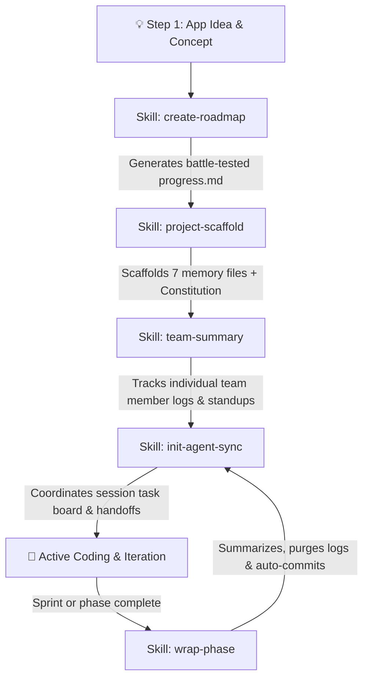

# 🤖 Agentic Skills System

> **A battle-tested suite of plug-and-play AI agent skills for project scaffolding, 15-phase roadmaps, deterministic memory, team member logs, and multi-agent handoffs.**

[](LICENSE)
[]()
[](#-contributing)

---

## 💡 Why This Exists

Most AI coding agents suffer from **context amnesia**: they build quick, unstructured MVPs, forget architectural constraints across sessions, hallucinate missing variables, lose track of team members' contributions, and leave messy git histories. 

This repository provides **deterministic, production-grade agent skills** that transform any AI assistant (Antigravity, Gemini, OpenCode, Claude Code, Cursor) into a disciplined engineering partner with persistent memory, team coordination, and structured workflows.

---

## ⚡ The Project Lifecycle Flow

The 5 skills work in harmony to guide your software project from an initial concept to full team development, store publishing, and maintenance:



---

## 🛠️ The 5 Available Skills

| Skill | Role | When to Use | Output Artifacts |
| :--- | :--- | :--- | :--- |
| **[`create-roadmap`](./create-roadmap/)** | **Master Product Roadmap** | Right after you pitch or explain a new app idea | `progress.md` (15 progressive phases) |
| **[`project-scaffold`](./project-scaffold/)** | **Project Memory & Constitution** | Starting a new repository or structuring an existing one | `gemini.md`, `AGENT_SYNC.md`, `findings.md`, `crash-log.txt`, `.env` |
| **[`team-summary`](./team-summary/)** | **Individual Member Summaries** | Logging who did what without overwriting teammates | `TEAM_SUMMARY.md` (isolated member standups & roster) |
| **[`init-agent-sync`](./init-agent-sync/)** | **Inter-Agent Coordination Hub** | When coordinating active AI agents or sessions | `AGENT_SYNC.md` (task board & handoff log) |
| **[`wrap-phase`](./wrap-phase/)** | **Sprint Wrap-up & Auto-Commit** | When finishing a phase or ending a development turn | Cleaned `AGENT_SYNC.md` + Git commit & push |

---

### 1. `create-roadmap`
*Transforms raw ideas into an actionable 15-phase roadmap modeled after production systems.*

- **What it does**: Analyzes your app concept and builds a comprehensive `progress.md` file. It breaks down development into foundational infrastructure, data layers, modular features, settings, legal/privacy, monetization gating, security, and store release.
- **Why it matters**: Prevents agents from rushing to UI before establishing database schemas and background lifecycles.
- **Trigger phrases**:
  - *"Plan out this app idea into phases"*
  - *"Create the progress.md file"*
  - *"Generate a roadmap for my new app"*

---

### 2. `project-scaffold`
*Scaffolds deterministic project memory and streamlines the B.L.A.S.T. protocol for any tech stack.*

- **What it does**: Establishes the essential project memory files:
  1. `gemini.md` (Project Constitution: data schemas & invariants)
  2. `AGENT_SYNC.md` (Multi-agent synchronization hub)
  3. `progress.md` (Master phase roadmap)
  4. `task_plan.md` (Active sprint blueprint)
  5. `findings.md` (Technical discoveries, OS gotchas & constraints)
  6. `crash-log.txt` (Error triage, stack traces & repair notes)
  7. `.env.example` & `.gitignore` (Zero-secrets enforcement)
- **Why it matters**: Gives your agents long-term institutional memory so they never repeat mistakes or leak API credentials.
- **Trigger phrases**:
  - *"Scaffold this project"*
  - *"Initialize project memory"*
  - *"Set up project governance like Floatkit"*

---

### 3. `team-summary`
*Maintains individual, isolated work summaries for each team member or AI agent persona in `TEAM_SUMMARY.md`.*

- **What it does**: Creates and updates `TEAM_SUMMARY.md`, maintaining an at-a-glance Team Roster table followed by isolated sections for each contributor. Each member has their own dedicated area recording:
  - Role & domain ownership
  - Active focus & next tasks
  - Recent accomplishments with dates
  - Files touched / owned
  - Blockers & notes for peers
- **Why it matters**: In multi-developer or multi-agent teams, contributors often overwrite each other's status notes. `team-summary` guarantees that every member's work history remains distinct and protected.
- **Trigger phrases**:
  - *"Update my team summary"*
  - *"Log what I did in the team file"*
  - *"Add member summary for [Name]"*
  - *"Create TEAM_SUMMARY.md"*

---

### 4. `init-agent-sync`
*Initializes a lightweight agent coordination and handoff hub.*

- **What it does**: Creates an `AGENT_SYNC.md` file with a live session task board (`[ ]`, `[~]`, `[x]`), active branch status, and a dated chronological handoff log.
- **Why it matters**: Allows you to switch between different models or chat sessions without losing current context.
- **Trigger phrases**:
  - *"Initialize agent sync"*
  - *"Set up the agent handoff hub"*

---

### 5. `wrap-phase`
*Summarizes accomplishments, prunes stale logs, and commits your progress.*

- **What it does**: Reads your session work, appends a structured `## 📖 Phase Summary` to `AGENT_SYNC.md`, clears completed tasks, keeps only the most recent handoff message, and automatically stages, commits, and pushes to git.
- **Why it matters**: Keeps your coordination files clean, concise, and token-efficient.
- **Trigger phrases**:
  - *"Wrap up the phase"*
  - *"Wrap the phase and clean AGENT_SYNC"*

---

## 🚀 Installation & Setup Guide

You can install these skills **globally** (available in every project on your machine) or **locally** (checked into a specific project).

### 📂 Where Do Skills Live?

| Platform / Assistant | Project Scope (Local) | Global Scope (All Projects) |
| :--- | :--- | :--- |
| **Google Antigravity / Gemini** | `.agents/skills/<skill-name>/` | `~/.gemini/config/skills/<skill-name>/` |
| **OpenCode** | `.opencode/skills/<skill-name>/` | `~/.config/opencode/skills/<skill-name>/` |
| **Claude Code / Cursor / Generic** | `.skills/<skill-name>/` | `~/.skills/<skill-name>/` |

---

### Method 1: Quick Install (Copy & Paste Commands)

#### 🖥️ For Google Antigravity & Gemini CLI

**Install Globally (Recommended — available across all projects):**

*Windows (PowerShell):*
```powershell
# Create global directories and download skills
$skills = @("create-roadmap", "project-scaffold", "team-summary", "init-agent-sync", "wrap-phase")
foreach ($s in $skills) {
    New-Item -ItemType Directory -Force "$HOME\.gemini\config\skills\$s"
    Invoke-WebRequest -Uri "https://raw.githubusercontent.com/Hadi99K/AGENT_SKILLS/main/$s/SKILL.md" -OutFile "$HOME\.gemini\config\skills\$s\SKILL.md"
}
```

*macOS / Linux (Bash):*
```bash
for s in create-roadmap project-scaffold team-summary init-agent-sync wrap-phase; do
  mkdir -p ~/.gemini/config/skills/$s
  curl -fsSL https://raw.githubusercontent.com/Hadi99K/AGENT_SKILLS/main/$s/SKILL.md -o ~/.gemini/config/skills/$s/SKILL.md
done
```

**Install in Current Project Only:**

*Windows (PowerShell):*
```powershell
$skills = @("create-roadmap", "project-scaffold", "team-summary", "init-agent-sync", "wrap-phase")
foreach ($s in $skills) {
    New-Item -ItemType Directory -Force ".agents\skills\$s"
    Invoke-WebRequest -Uri "https://raw.githubusercontent.com/Hadi99K/AGENT_SKILLS/main/$s/SKILL.md" -OutFile ".agents\skills\$s\SKILL.md"
}
```

*macOS / Linux (Bash):*
```bash
for s in create-roadmap project-scaffold team-summary init-agent-sync wrap-phase; do
  mkdir -p .agents/skills/$s
  curl -fsSL https://raw.githubusercontent.com/Hadi99K/AGENT_SKILLS/main/$s/SKILL.md -o .agents/skills/$s/SKILL.md
done
```

---

#### 🌐 For OpenCode Users

**Project-level install:**
```bash
# Pick and install what you need
mkdir -p .opencode/skills/create-roadmap && curl -o .opencode/skills/create-roadmap/SKILL.md https://raw.githubusercontent.com/Hadi99K/AGENT_SKILLS/main/create-roadmap/SKILL.md
mkdir -p .opencode/skills/project-scaffold && curl -o .opencode/skills/project-scaffold/SKILL.md https://raw.githubusercontent.com/Hadi99K/AGENT_SKILLS/main/project-scaffold/SKILL.md
mkdir -p .opencode/skills/team-summary && curl -o .opencode/skills/team-summary/SKILL.md https://raw.githubusercontent.com/Hadi99K/AGENT_SKILLS/main/team-summary/SKILL.md
mkdir -p .opencode/skills/init-agent-sync && curl -o .opencode/skills/init-agent-sync/SKILL.md https://raw.githubusercontent.com/Hadi99K/AGENT_SKILLS/main/init-agent-sync/SKILL.md
mkdir -p .opencode/skills/wrap-phase && curl -o .opencode/skills/wrap-phase/SKILL.md https://raw.githubusercontent.com/Hadi99K/AGENT_SKILLS/main/wrap-phase/SKILL.md
```

*(For global OpenCode install, replace `.opencode/skills/` with `~/.config/opencode/skills/`)*

---

### Method 2: Full Git Clone

If you want to explore the repository or contribute:

```bash
git clone https://github.com/Hadi99K/AGENT_SKILLS.git
cd AGENT_SKILLS
```

You can then copy any skill folder directly into your project's skill directory:
```bash
# Example: Copy team-summary to your Antigravity project
cp -r team-summary /path/to/your/project/.agents/skills/
```

---

### Method 3: Manual Download (No Terminal Needed)

1. Navigate to the skill folder above (e.g., [`team-summary/SKILL.md`](./team-summary/SKILL.md)).
2. Click the **Raw** button in the top right.
3. Press `Ctrl + A` (or `Cmd + A`), then `Ctrl + C` (or `Cmd + C`) to copy.
4. In your project, create the folder `.agents/skills/<skill-name>/` (or `.opencode/skills/<skill-name>/`).
5. Create a file named `SKILL.md` inside that folder and paste the text.

---

## 🎯 How to Use Once Installed

Once installed, your AI agent automatically detects the skills. Simply prompt your agent naturally:

1. **New App Idea:**
   > *"Here is my idea for an Android productivity app: [Describe idea]. Use the `create-roadmap` skill to build our roadmap."*
2. **Project Setup:**
   > *"Run the `project-scaffold` skill to set up our project memory and constitution."*
3. **Team Activity & Standups:**
   > *"Update my section in `TEAM_SUMMARY.md` with the dock layout fixes we finished today."*
4. **Session Handoff:**
   > *"Update `AGENT_SYNC.md` with what we did and prep for the next session."*
5. **Sprint Wrap-up:**
   > *"Use `wrap-phase` to wrap up Phase 1, summarize what was built, and commit."*

---

## 🤝 Contributing

We welcome community skills, improvements, and translations!

1. **Fork** the repository.
2. **Create a branch**:
   ```bash
   git checkout -b feat/add-new-skill
   ```
3. **Create your skill**:
   - Create a folder: `<skill-name>/`
   - Include a valid `SKILL.md` with standard YAML frontmatter:
     ```yaml
     ---
     name: your-skill-name
     description: Concise summary of what the skill accomplishes.
     license: MIT
     compatibility: opencode
     metadata:
       audience: developers
       workflow: team-collaboration
     ---
     ```
4. **Commit & Push**:
   ```bash
   git commit -m "feat: add your-skill-name skill"
   git push origin feat/add-new-skill
   ```
5. **Open a Pull Request** with a brief demo of the skill in action.

---

## 📄 License

This repository is open-source under the [MIT License](LICENSE).  
Maintained with ❤️ by [Hadi99K](https://github.com/Hadi99K).
