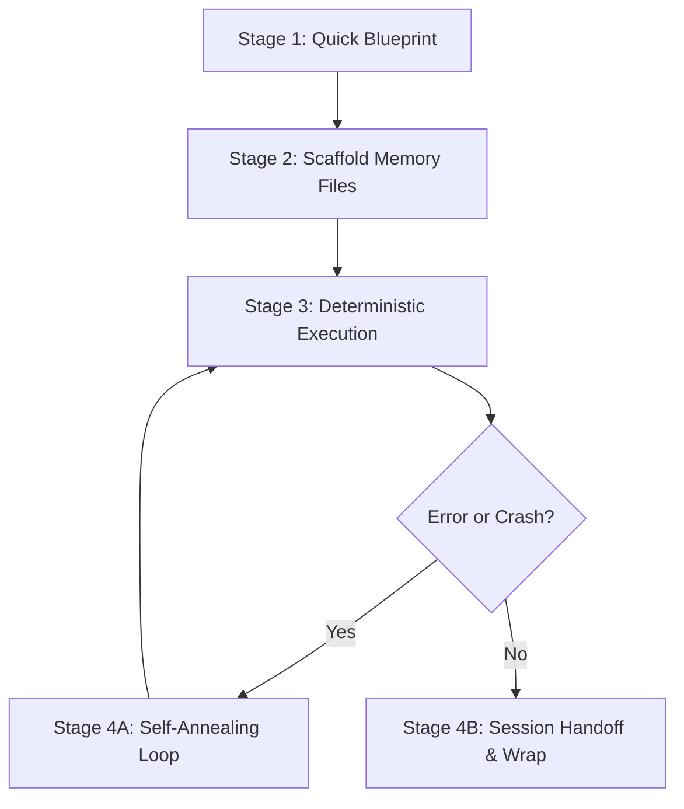

# 🏗️ Project Scaffold & Multi-Agent Memory System

## What I Do
1. **Initialize Project Memory**: Create the essential governance and state-tracking files (`gemini.md`, `AGENT_SYNC.md`, `progress.md`, `task_plan.md`, `findings.md`, `crash-log.txt`, `.env.example`, `.gitignore`).
2. **Establish the Constitution**: Define core data schemas, behavioral invariants (privacy, offline, security), and the "No Secrets in Code" law before writing application logic.
3. **Streamline B.L.A.S.T.**: Simplify the heavy 5-phase B.L.A.S.T. protocol into an agile 4-stage workflow (Blueprint -> Scaffold -> Execute -> Self-Anneal/Handoff) that works for any tech stack (Android, Web, iOS, Node, Python, Rust, etc.).
4. **Enable Seamless Multi-Agent Handoffs**: Maintain synchronized context so any AI agent can wake up, read `AGENT_SYNC.md`, and immediately resume work without asking repetitive questions.

---

## When to Use Me
- When starting a brand-new project or repository.
- When introducing structured agent coordination to an existing codebase that lacks documentation or memory.
- When the user asks: *"initialize project memory"*, *"scaffold project"*, *"set up agent sync"*, or *"create files like Floatkit / BLAST"*.

---

## 🏛️ The 7 Essential Files

| File | Role | Purpose |
| :--- | :--- | :--- |
| **`gemini.md`** | **Project Constitution** | Immutable data schemas (JSON shapes), architectural invariants, security rules, and non-negotiables. |
| **`AGENT_SYNC.md`** | **Agent Coordination Hub** | Real-time session task board (`[ ]`, `[~]`, `[x]`), active branch/phase state, and chronological agent handoff logs. |
| **`progress.md`** | **Master Product Roadmap** | Long-term roadmap broken into numbered phases and milestones with feature completion status. |
| **`task_plan.md`** | **Active Sprint Blueprint** | Immediate sprint plan for the current phase: objectives, architectural guardrails, and granular checklists. |
| **`findings.md`** | **Research & Discoveries** | Institutional knowledge: OS/framework quirks, API gotchas, hardware constraints, and architectural decisions. |
| **`crash-log.txt`** | **Runtime Triage & Errors** | Raw runtime exceptions, crash stack traces, reproduction parameters, and root-cause repair notes. |
| **`.env.example` / `.gitignore`** | **Secrets & Hygiene** | Credential isolation enforcing the Zero Secrets Law and repository cleanliness. |

---

## ⚡ Execution Protocol: The 4-Stage Lifecycle



### Stage 1: Quick Blueprint (Discovery Alignment)
Before scaffolding files, briefly ask or confirm with the user (or inspect the workspace for):
1. **The North Star**: What is the singular goal and primary platform of this project? (e.g., Android overlay, Next.js web app, CLI utility)
2. **Core Entities**: What are the 2–4 primary data models? (e.g., User, Note, Task, Transaction)
3. **Non-Negotiables**: What are the hard rules? (e.g., zero secret leaks, 8pt spacing grid)

---

### Stage 2: Scaffold Project Memory Files
Create the essential files in the project root if they do not already exist.

#### 1. `gemini.md` (Project Constitution)
```markdown
# 🏛️ Project Constitution

## 1. Data Schemas (JSON Ground Truth)
<!-- Define primary entity shapes before building tools or components -->
```json
{
  "entity": {
    "id": "uuid | string",
    "createdAt": "timestamp",
    "updatedAt": "timestamp"
  }
}
```

## 2. Architectural Invariants
- **Platform Stack:** [e.g., Kotlin + Jetpack Compose / React + Vite / Python + FastAPI]
- **Storage Strategy:** [e.g., Room DB + DataStore / PostgreSQL / LocalStorage]
- **State Flow:** Single source of truth with unidirectional data flow.

## 3. Behavioral Guardrails
- **Offline & Privacy:** [e.g., 100% offline by default; no tracking or telemetry]
- **Performance:** [e.g., Strict 60fps UI, minimal background battery/RAM footprint]
- **The Zero Secrets Law:** No API keys, tokens, or credentials committed in code. All secrets in gitignored `.env` or `local.properties`.
```

#### 2. `AGENT_SYNC.md` (Agent Coordination Hub)
```markdown
# 🔄 Agent Synchronization & Handoff Hub

**🚨 INSTRUCTIONS FOR ALL AI AGENTS 🚨**
1. **Read this file first** upon waking up or starting a new session.
2. **Check the Handoff Log** for context, recent changes, and blockers.
3. **Master Reference:** High-level milestones live in `progress.md`. Use this file for active, session-level tasks.
4. **Task Updates:** When starting a task, mark as `[~] In Progress`. When finished, mark as `[x] Completed`.
5. **Session Wrap-up:** Append a concise 2–3 line summary to the **Handoff Log** before ending your turn.

---

## 📍 Current Context & Technical State
- **Active Branch:** `main`
- **Current Phase:** Phase 1 - Foundation Setup
- **Master Reference:** `progress.md`

---

## 📋 Session Task Board (Granular / Short-Term)
- [ ] Initialize project scaffolding
- [ ] Verify build environment & dependencies
- [ ] Implement initial entity data models

---

## 🤝 Handoff & Discussion Log
**[YYYY-MM-DD] - Agent 1:**
- **Initial Setup:** Initialized project memory and constitution files. Ready for Phase 1 execution.
```

#### 3. `progress.md` (Master Roadmap)
```markdown
# 🗺️ Master Project Roadmap

## 📌 Milestone Overview
- **Phase 1: Core Foundation & Service Setup** `[IN PROGRESS]`
- **Phase 2: Data Persistence & Business Logic** `[PENDING]`
- **Phase 3: UI/UX & Interactions** `[PENDING]`
- **Phase 4: Hardening, Edge Cases & Polish** `[PENDING]`

---

## 🔌 Phase 1: Core Foundation & Service Setup
- [ ] Project scaffolding & dependency wiring
- [ ] Core lifecycle/service infrastructure
- [ ] Base configuration & error handling

## 🗄️ Phase 2: Data Persistence & Business Logic
- [ ] Database schema & migrations
- [ ] Repositories & state management
- [ ] Unit tests for core operations

## 🎨 Phase 3: UI/UX & Interactions
- [ ] Design system tokens (spacing rhythm, typography, color palette)
- [ ] Primary screens and responsive layouts
- [ ] Empty states, loading indicators, and user feedback

## 🛡️ Phase 4: Hardening, Edge Cases & Polish
- [ ] Crash triage & lifecycle edge cases
- [ ] Performance profiling & optimization
- [ ] Security audit & zero-secret verification
```

#### 4. `task_plan.md` (Active Sprint Blueprint)
```markdown
# 🎯 Task Plan: Phase 1 - Core Foundation

## Objective
[Clear, 1-2 sentence description of the immediate outcome for this sprint.]

## Architectural & Security Guardrails
1. Adhere strictly to schemas defined in `gemini.md`.
2. All secrets must live in `.env` or `local.properties`.
3. Validate all inputs and handle edge-case exceptions gracefully.

## Execution Checklist
- [ ] Step 1: Set up configuration and verify link handshake
- [ ] Step 2: Implement core logic and verify build
- [ ] Step 3: Run validation tests and audit secrets
```

#### 5. `findings.md` (Research & Discoveries)
```markdown
# 🧠 Research, Discoveries & Constraints

## Technical Discoveries
- *[Record platform quirks, OS limitations, or library behaviors discovered during development]*

## Constraints & Gotchas
- *[Record security limits, lifecycle constraints, or rate limits so future agents never repeat mistakes]*

## Architectural Decisions (ADRs)
- *[Record why a specific library, pattern, or approach was chosen over alternatives]*
```

#### 6. `crash-log.txt` (Error & Crash Triage)
```text
=== CRASH & ERROR TRIAGE LOG ===
Format:
timestamp: [Epoch or ISO timestamp]
component: [File / Class / Service name]
error: [Exception class & short message]
stacktrace:
[Paste full stack trace here]
root_cause: [Brief analysis of why it occurred]
fix_applied: [Description of the fix implemented]
================================
```

#### 7. `.env.example` & `.gitignore`
**`.env.example`**:
```bash
# Example Environment Variables (DO NOT PUT REAL SECRETS HERE)
API_KEY=your_api_key_here
BASE_URL=https://api.example.com
DEBUG_MODE=true
```

Ensure `.gitignore` contains:
```gitignore
# Secrets & local config
.env
local.properties
*.jks
*.keystore

# Build & temporary files
.tmp/
build/
dist/
node_modules/
*.log
```

---

### Stage 3: Deterministic Execution & Sync
1. **Read-Before-Write**: Before touching code, review `gemini.md` (for schemas) and `findings.md` (for known traps).
2. **Maintain the Task Board**: Keep `AGENT_SYNC.md` updated in real time:
   - Mark task `[~] In Progress` when starting.
   - Mark task `[x] Completed` when validated.
3. **Record Discoveries**: If a platform quirk, OS restriction, or undocumented library behavior is encountered, write it into `findings.md` immediately.

---

### Stage 4: Self-Anneal & Handoff

#### 4A: Self-Annealing Repair Loop (When Errors Occur)
1. **Capture**: When a build fails, an exception is thrown, or a crash occurs, append the raw error to `crash-log.txt`.
2. **Diagnose**: Analyze the exact stacktrace and line number. Never guess or apply blind patches.
3. **Patch & Verify**: Apply the minimal surgical fix and verify with a clean build/test.
4. **Update Memory**: Record the root cause and lesson in `findings.md` so future agents never repeat the same mistake.

#### 4B: Session Handoff & Wrap-up
Before ending an agent session or completing a feature:
1. Ensure all code compiles cleanly and unit tests pass.
2. Run a secrets audit (verify no keys are exposed in git status or diff).
3. Update `progress.md` with newly completed milestones.
4. Append a concise 2–3 line summary to `## 🤝 Handoff & Discussion Log` in `AGENT_SYNC.md`:
   ```markdown
   **[YYYY-MM-DD] - Agent [Name/ID]:**
   - **Built:** [Key feature / fix completed]
   - **Status:** Build verified (0 errors, 0 secrets exposed).
   - **Next:** [Immediate next task for the following agent/session]
   ```
